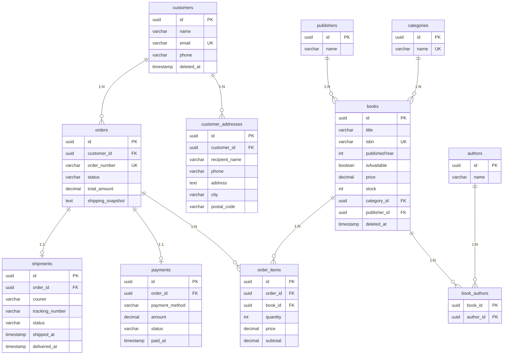

# BookStore E-Commerce API

Tugas **Studi Kasus Relasi Database** — NestJS + TypeORM + PostgreSQL.
Berisi 11 tabel sesuai dokumen tugas, REST API lengkap, validasi, soft delete, dan alur checkout yang transaksional.

---

## 1. Kebutuhan

| Software | Versi | Cek |
|---|---|---|
| Node.js | 20 atau lebih baru | `node -v` |
| npm | 9+ | `npm -v` |
| PostgreSQL | 14+ **atau** Docker | `docker -v` |

## 2. Cara Menjalankan

```bash
# 1. Masuk ke folder project
cd bookstore-api

# 2. Install dependency
npm install

# 3. Siapkan konfigurasi (file .env sudah ada; jika tidak, salin dari contoh)
cp .env.example .env

# 4. Jalankan database PostgreSQL (pilih SALAH SATU)
#    a) Dengan Docker (paling mudah):
docker compose up -d
#    b) Tanpa Docker: install PostgreSQL sendiri, lalu buat database kosong bernama "bookstore"
#       (sesuaikan DB_USERNAME / DB_PASSWORD di file .env)

# 5. Jalankan aplikasi (tabel dibuat otomatis oleh TypeORM)
npm run start:dev

# 6. (Opsional) isi data contoh - jalankan di terminal lain
npm run seed
```

Setelah jalan:
- API  : http://localhost:3000
- **Swagger UI (coba semua endpoint lewat browser)** : http://localhost:3000/docs

> `DB_SYNCHRONIZE=true` membuat tabel otomatis dari entity (cocok untuk belajar/dev).
> Untuk production gunakan migration dan set `false`.

## 3. Struktur Folder

```
src/
├── entities/        # 11 entity TypeORM (1 file = 1 tabel)
├── common/          # enum status, transformer DECIMAL, filter error database
├── customers/       # customers + customer_addresses
├── categories/      # categories
├── publishers/      # publishers
├── authors/         # authors
├── books/           # books + book_authors (many-to-many)
├── orders/          # orders + order_items (checkout)
├── payments/        # payments
├── shipments/       # shipments
├── app.module.ts    # koneksi database + registrasi modul
├── main.ts          # bootstrap, ValidationPipe, Swagger
└── seed.ts          # data contoh
```

## 4. ERD (relasi antar tabel)



## 5. Keputusan Desain (sesuai catatan di dokumen tugas)

| Poin di dokumen | Implementasi |
|---|---|
| Tambah `price` & `stock` di `books` | Ada. `price` = `DECIMAL(12,2)` (bukan float), `stock` = `INT` |
| `isbn` UNIQUE | Ada |
| `isAvailable` harus sinkron dengan stok | Stok 0 -> `isAvailable` otomatis `false` (saat buat/ubah buku & checkout). Stok kembali saat order dibatalkan |
| Soft delete | `customers` & `books` memakai `deleted_at` (`DELETE` hanya mengisi `deleted_at`) |
| Kolom `author` di `books` dihapus bila memakai `authors` + `book_authors` | **Dihapus** untuk menghindari redundansi. Penulis dikelola lewat many-to-many |
| `title` 30 & `author` 25 karakter sebaiknya diperbesar | `title` diperbesar menjadi `VARCHAR(255)` |
| `category_id` & `publisher_id` di `books` | Ada (nullable, `ON DELETE SET NULL`) |
| `book_authors` PK gabungan | `PRIMARY KEY (book_id, author_id)` |
| Snapshot alamat di `orders` | Alamat disalin ke kolom `shipping_*` di `orders` saat checkout |
| `order_items.price` = snapshot harga | Harga buku saat checkout disalin; perubahan `books.price` tidak mengubah riwayat |
| `total_amount` konsisten dengan detail | Dihitung server dari `SUM(subtotal)`, client tidak bisa mengirim total |
| `payments.order_id` UNIQUE | Ada (One-to-One, rancangan sederhana) |
| `shipments.order_id` UNIQUE | Ada (One-to-One, rancangan sederhana) |
| Integritas data | Foreign key, `CHECK (stock >= 0)`, `CHECK (price >= 0)`, `CHECK (quantity > 0)`, transaksi database + row lock saat checkout agar stok tidak oversell |

## 6. Alur Bisnis

```
POST /orders ........ status: pending  (stok berkurang, harga & alamat di-snapshot)
POST /payments ...... payment: pending (amount otomatis = total order)
PATCH /payments/:id/status {"status":"paid"} ... payment: paid,  order: paid
POST /shipments ..... shipment: preparing,       order: processing
PATCH /shipments/:id/status {"status":"shipped"}   ... order: shipped
PATCH /shipments/:id/status {"status":"delivered"} ... order: completed
```

Pembatalan: `PATCH /orders/:id/status {"status":"cancelled"}` (hanya dari pending/paid/processing) -> stok dikembalikan.
Transisi status yang tidak valid ditolak dengan HTTP 409.

## 7. Daftar Endpoint

| Resource | Endpoint |
|---|---|
| Customers | `POST/GET /customers`, `GET/PATCH/DELETE /customers/:id` |
| Addresses | `POST/GET /customers/:customerId/addresses`, `PATCH/DELETE /customers/:customerId/addresses/:addressId` |
| Categories | `POST/GET /categories`, `GET/PATCH/DELETE /categories/:id` |
| Publishers | `POST/GET /publishers`, `GET/PATCH/DELETE /publishers/:id` |
| Authors | `POST/GET /authors`, `GET/PATCH/DELETE /authors/:id` |
| Books | `POST/GET /books` (filter: `?search=&categoryId=&publisherId=`), `GET/PATCH/DELETE /books/:id` |
| Orders | `POST/GET /orders` (filter: `?customerId=`), `GET /orders/:id`, `PATCH /orders/:id/status` |
| Payments | `POST/GET /payments`, `GET /payments/:id`, `PATCH /payments/:id/status` |
| Shipments | `POST/GET /shipments`, `GET /shipments/:id`, `PATCH /shipments/:id/status` |

## 8. Contoh Request (cURL)

Ganti `<...>` dengan ID asli (lihat hasil response sebelumnya, atau jalankan `npm run seed` lalu `GET /customers`).

```bash
# Buat kategori, penerbit, penulis
curl -X POST localhost:3000/categories -H "Content-Type: application/json" -d '{"name":"Programming"}'
curl -X POST localhost:3000/publishers -H "Content-Type: application/json" -d '{"name":"Prentice Hall"}'
curl -X POST localhost:3000/authors    -H "Content-Type: application/json" -d '{"name":"Robert C. Martin"}'

# Buat buku (relasi kategori, penerbit, banyak penulis)
curl -X POST localhost:3000/books -H "Content-Type: application/json" -d '{
  "title":"Clean Code","isbn":"9780132350884","publishedYear":2008,
  "price":150000,"stock":20,
  "categoryId":"<category-id>","publisherId":"<publisher-id>","authorIds":["<author-id>"]
}'

# Buat customer + alamat
curl -X POST localhost:3000/customers -H "Content-Type: application/json" \
  -d '{"name":"Budi","email":"budi@mail.com","phone":"0812345"}'
curl -X POST localhost:3000/customers/<customer-id>/addresses -H "Content-Type: application/json" \
  -d '{"recipientName":"Budi","phone":"0812345","address":"Jl. Merdeka 10","city":"Pekalongan","postalCode":"51111"}'

# Checkout
curl -X POST localhost:3000/orders -H "Content-Type: application/json" -d '{
  "customerId":"<customer-id>","addressId":"<address-id>",
  "items":[{"bookId":"<book-id>","quantity":2}]
}'

# Bayar -> kirim -> selesai
curl -X POST  localhost:3000/payments -H "Content-Type: application/json" -d '{"orderId":"<order-id>","paymentMethod":"bank_transfer"}'
curl -X PATCH localhost:3000/payments/<payment-id>/status -H "Content-Type: application/json" -d '{"status":"paid"}'
curl -X POST  localhost:3000/shipments -H "Content-Type: application/json" -d '{"orderId":"<order-id>","courier":"JNE"}'
curl -X PATCH localhost:3000/shipments/<shipment-id>/status -H "Content-Type: application/json" -d '{"status":"shipped","trackingNumber":"JNE123"}'
curl -X PATCH localhost:3000/shipments/<shipment-id>/status -H "Content-Type: application/json" -d '{"status":"delivered"}'
```

## 9. Melihat Tabel di Database

```bash
# Docker
docker exec -it bookstore-db psql -U postgres -d bookstore -c "\dt"
docker exec -it bookstore-db psql -U postgres -d bookstore -c "\d books"
```
Atau gunakan DBeaver / pgAdmin / TablePlus dengan host `localhost`, port `5432`, user `postgres`, password `postgres`, database `bookstore`.
Fitur diagram di DBeaver (klik kanan database -> *View Diagram*) bisa dipakai untuk screenshot ERD final laporan.

## 10. Troubleshooting

| Masalah | Solusi |
|---|---|
| `ECONNREFUSED 127.0.0.1:5432` | PostgreSQL belum jalan. Jalankan `docker compose up -d` dan tunggu beberapa detik |
| `password authentication failed` | Samakan `DB_USERNAME`/`DB_PASSWORD` di `.env` dengan PostgreSQL Anda |
| `database "bookstore" does not exist` | Buat dulu: `CREATE DATABASE bookstore;` (otomatis jika memakai docker compose) |
| Port 3000 / 5432 sudah dipakai | Ubah `PORT` / `DB_PORT` di `.env` (dan mapping port di `docker-compose.yml`) |
| Reset total database | `docker compose down -v` lalu `docker compose up -d` |
